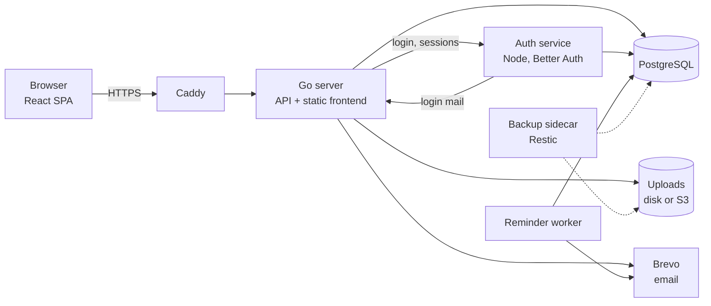

# AbiZeitBetrug

A German-language web portal for a school graduating class. It collects polls, texts and photos for the yearbook (*Abizeitung*) and gives the editorial team tools to run the project.

Built with **Go, PostgreSQL, React and TypeScript**, deployed with Docker Compose. This repository holds source code only, no real school data.

## What it does

**Polls and contributions**

- Polls with proposed options, polls that pick people from the class roster, and word polls with a word cloud for editors.
- Text, quote, photo and profile-page (*Steckbrief*) submissions with revision history.
- Deadlines, a draft/open/closed lifecycle and email reminders.

**Editorial and project tools**

- Review and annotate submissions, request corrections, moderate poll words without overwriting the originals.
- Export a collection as ZIP with CSV, original photos and a manifest.
- Project workspace (behind a feature flag): Kanban board with review and approval rules, shared Markdown documents.

**Administration**

- Roles and per-category permissions, activity log, backup status.
- Email quota management and masked delivery history.

## Architecture



| Layer | Technology |
| --- | --- |
| Frontend | React 19, TypeScript, Vite, Tailwind CSS, TanStack Query, Base UI |
| Backend | Go (`net/http`), pgx, PostgreSQL 18 with SQL migrations |
| Authentication | Better Auth: email magic links, passkeys (WebAuthn), optional Google sign-in |
| Operations | Docker Compose, Caddy, Ansible, GitHub Actions, GHCR, Restic |

## Engineering highlights

- **One source of truth for the API.** The OpenAPI spec is generated from the Go route table and types, and the TypeScript types are generated from the spec. CI rejects stale files, and a test rejects API routes that bypass the table.
- **Permissions tested as a matrix.** Every API route in the contract is tested for session, admission, CSRF protection and role.
- **Data integrity under concurrency.** Row locks, advisory locks and `SKIP LOCKED` job claiming, with database triggers guarding identity and erasure rules.
- **Privacy by design.** Consent gate, GDPR erasure command, named ballots visible to admins only, no public uploads, no AI processing of contributions, self-hosted fonts.
- **Security hardening.** `__Host-` cookies, Content Security Policy, closed sign-up, and dependency vulnerability audits (`govulncheck`, `npm audit`) in CI.
- **Tested recovery.** A CI job runs a backup and restore drill in throwaway containers.
- **Preview environments.** Pull requests can get isolated, resource-limited deployments that expire automatically.
- **Testing.** Go tests with the race detector against a real PostgreSQL, Vitest component tests, Playwright browser journeys including responsive layout checks.

As of November 2026, the portal's Go server and web frontend are about 19,000 lines of code, plus 12,500 lines of tests.

## Run locally

Requires Docker.

```sh
make dev    # build and start the stack with demo data and a mock login
make down   # stop it, keeping data
```

The portal runs at <https://localhost> by default. The certificate is locally issued, so the browser warns. `make dev:auth` swaps the mock login for the real auth service and needs Brevo credentials in `.env.dev`.

```sh
make check                      # tests and static checks; needs Go and Node
bash scripts/test-recovery.sh   # backup/restore drill
```

Database tests are skipped unless `TEST_DATABASE_URL` is set. Point it only at a **disposable** PostgreSQL database.

## Documentation

- [Repository map](docs/repo-map.md): where everything lives
- [API contract and permissions](docs/implementation-contract.md) and [OpenAPI spec](docs/openapi.json)
- [UI style guide](docs/style-guide.md)
- [Authentication and email operations](docs/auth-email-operations.md)
- [Backup, restore and deployment](ops/README.md) and [Ansible setup](ops/ansible/README.md)
